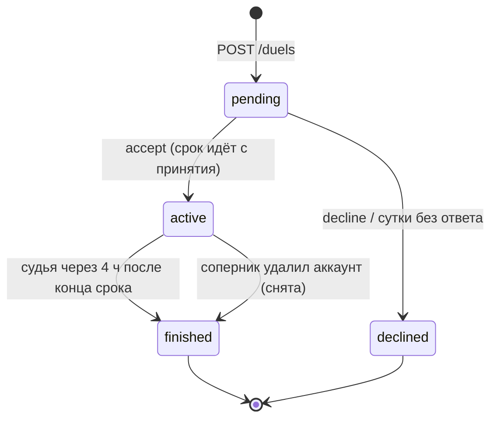

# Дуэли 1×1

PLAN.md, [§3.14](../PLAN.md#314-дуэли-11) (дуэли), §3.7 (дуэльный значок), §3.17 (уведомления), §3.16 (приватность).
Задача E17 [#147](https://github.com/Nikich196/gorodki/issues/147) — сделано Claude 15.10 (решение Никиты «всё должно
работать сразу»).

Код: `backend/src/Gorodki.Api/Features/Duels` — `DuelEndpoints` (адреса и лимиты), `DuelScores` (живой счёт),
`DuelReferee` (задача Hangfire: истёкшие вызовы, лидер, итог; общие помощники), `DuelHooks` (точки подключения);
правила — `Gorodki.Domain/Duels/DuelRules.cs` (чистые функции, тесты без Docker); таблица `app.duels`.

## Адреса

| Адрес | Что делает | Ошибки |
|---|---|---|
| `GET /duels` | Свои дуэли: ждущие ответа, идущие, законченные и отклонённые за 30 дней. Сначала ждущие, потом идущие, потом законченные; внутри — новые выше | — |
| `POST /duels` | Вызов взаимного друга: `opponentId`, `league`, `metric`, `days`, `segmentId` (только у `segmentTime`), `stakeItemId` (по желанию) → 201 и дуэль `pending` | 400 `duel_invalid`, 404 `duel_opponent_not_found`, 409 `duel_account_too_new` / `duel_limit` / `duel_pair_week` / `duel_stake_invalid` |
| `GET /duels/{id}` | Дуэль с живым счётом | 404 `duel_not_found` (не своя или нет такой) |
| `POST /duels/{id}/accept` | Принять (только вызванный, вызов ждёт ответа меньше суток) → `active`, срок — с этого момента | 404 `duel_not_found`, 409 `duel_account_too_new` / `duel_limit` / `duel_stake_invalid` |
| `POST /duels/{id}/decline` | Отказаться (только вызванный) → `declined`, 204 | 404 `duel_not_found` |

В ответе `incoming` — «вызов пришёл мне» (я — вызванная сторона): у `pending` только вызванному показывать «Принять /
Отклонить»; у остальных — по факту, кто кого вызвал (единственная правка контракта в этой задаче, разрешена 15.10).
«Я» (`me`) — всегда спрашивающий. Ник соперника — по правилу карточки игрока (#115): с его согласия, иначе «Игрок #1234».

## Жизнь дуэли

- **Вызов ждёт ответа сутки** (`DuelRules.PendingLifetime`). Истёкший вызов адреса сразу показывают `declined` и не дают
  принять; строку закрывает судья (ставка вызвавшего — назад).
- **Конец срока — ещё не итог.** Петля последней минуты применяется до 3 ч спустя и видна через 20–25 минут, дистанция
  и туман забега, начатого перед концом, — после его конца и подсчёта визитов. Поэтому итог — через 4 ч после конца
  (`DuelReferee.SettleDelay` = `ScoreBook.CloseGrace`, тот же запас, что у закрытия сезона). До итога дуэль `active` с
  `endsAtMs` в прошлом — телефону писать «итог подводится».
- **Итог**: `finished`, `winnerId` — победитель; `null` — ничья или дуэль снята. Окончательный счёт замораживается в
  строке: откат захвата, забег из офлайна или удаление аккаунта после итога его не меняют.

## Защита от злоупотреблений (§3.14)

Всё ниже проверяется **под блокировками обоих игроков** (`pg_advisory_xact_lock(9, hashtext(id))` по порядку номеров —
[jobs.md](jobs.md#пространства-блокировок)): два вызова в одну секунду не проскочат лимит.

| Правило | Как |
|---|---|
| Только взаимные друзья | Строки `friend_links` в обе стороны (блокировка их стирает). Удаляемый аккаунт — «нет такого». При принятии — снова: раздружились — вызов не принять |
| Одна лига | Лига дуэли — в условиях; счёт — только по захватам и забегам этой лиги |
| «Одно устройство — один аккаунт» | Хоть один забег обоих с одного телефона (`runs.device_id`, установка из Keychain) — вызов `404 duel_opponent_not_found`, принятие `404 duel_not_found`; общий телефон, появившийся по ходу дуэли, — дуэль снимается при итоге |
| Аккаунт старше 48 ч | И у вызывающего, и у соперника при вызове; у принимающего — при принятии |
| ≤ 2 активных | Идущие дуэли игрока (с любой стороны, и ждущие итога) + **его же вызовы без ответа**: иначе можно разослать десять вызовов и получить десять дуэлей. Пришедшие ему вызовы место не занимают — их можно отклонить |
| Пара — не чаще раза в неделю | У пары (в любую сторону) есть ждущий вызов, идущая дуэль или дуэль, начатая меньше 7 дней назад. Отказ и истёкший вызов не в счёт — дуэли не было; ничья и снятая — в счёт |

Известная дыра (как в §3.9, «чужой телефон»): второй аккаунт, который ни разу не бегал с твоего телефона, правило
устройства не ловит.

## Счёт — граница публичности

Метрики (`DuelScores`), окно — [начало; конец):

| Метрика | Что | Окно | Посторонний видит |
|---|---|---|---|
| `capturedArea`, м² | «Взятое» применённых и не откаченных захватов (`captures.area_square_meters`) | Время петли (`effective_at`, §3.4) | С границы публичности применения (`TerritoryReader.PublicHorizon`, как карта и очки); демо — сразу |
| `exploredArea`, м² | Новые клетки тумана забегов (`runs.fog_new_cells`) × площадь клетки в Бресте (≈34,5 м²) | Начало забега по часам сервера | Когда конец забега публичен (`visits_processed_at`) |
| `distance`, м | Засчитанный путь (`runs.accepted_meters`) живых забегов | Начало забега по часам сервера | Он и считается только с визитами — после границы конца забега |
| `segmentTime`, мс | Лучшее время прохода отрезка (меньше — лучше) | Через `IDuelSegments` | Только проходы с публичным концом забега |

По настоящим кускам земли (`db.Parcels`) не считается ничего. Счёт округлён до 0,1; у идущей дуэли 0 — это «0», `null`
— «нет результата» (вызов не принят; у отрезка ни одного прохода).

**Два взгляда.** Соперника телефон получает как посторонний; **свой счёт — сразу**: «взятое» своих захватов (его автор и
так видит в итоге заявки) и свой туман, как только забег его открыл; своя дистанция — тоже после подсчёта визитов (путь
сервер считает только тогда). Сравнение «кто впереди» на экране — свой свежий счёт против публичного счёта соперника:
ничего скрытого о сопернике в нём нет, а соперник получает только публичный счёт игрока. **Лидер для уведомлений и итог —
только по публичному счёту обоих.** Иначе уведомление «соперник вышел вперёд» пришло бы через минуту после его петли и
выдало бы, что он бежит прямо сейчас.

## Судья — задача Hangfire `duels-referee`

Раз в 15 минут (`*/15 * * * *`, Минск; [jobs.md](jobs.md)). Три стадии, каждая дуэль — своя транзакция, ошибка одной
пишется в лог и не мешает остальным:

1. **Истёкшие вызовы** → `declined`, ставка вызвавшего — назад. Условный `UPDATE … WHERE status = pending`.
2. **Лидер идущих** (до конца срока): публичный счёт обоих → `duels.leader`; сменился и впереди теперь кто-то —
   `IDuelNotifier.LeaderChangedAsync`. Условный `UPDATE … WHERE leader = прежний`: повтор не уведомит дважды.
3. **Итог** (через 4 ч после конца): под блокировками обоих игроков (9) статус перечитывается — второй запуск находит
   дуэль законченной и ничего не делает. Публичный счёт обоих → исход (`DuelRules.Decide`), серия побед победителя,
   ставки (`IDuelStakes.SettleAsync`) и событие «итог» — **одной транзакцией**.

Тесты зовут стадии напрямую (`DuelsTests`): до конца запаса — `active`, после — итог ровно один раз.

## Ничья, снятая дуэль, значок

- **Ничья** — равный счёт после округления до 0,1 (в том числе 0 : 0). Победителя нет, ставки возвращаются.
- **Снята** (`outcome = cancelled`): общий телефон или соперник удалил аккаунт. Победителя нет, ставки возвращаются.
- **Серия побед** (`DuelRules.WinStreak`): сколько последних законченных дуэлей подряд выиграно; ничья и снятая серию не
  продолжают и не рвут, рвёт только поражение. Пишется в `duels.winner_streak` при итоге — это и есть дуэльный значок
  за эту победу: 1–2 — бронза, 3–4 — серебро, 5+ — золото (`DuelRules.BadgeFor`).
- **Где показать значок** (полей в контракте пока нет, контракт не менялся): в профиле и карточке игрока — текущая серия
  и редкость (`DuelStreaks.CurrentAsync`), у законченной дуэли в списке — значок за неё (`winner_streak`). Добавить —
  отдельной заготовкой контракта вместе с телефоном.

## Удаление аккаунта и «Мои данные»

- `AccountDeletion` до стирания игрока зовёт `DuelReferee.ForgetPlayerAsync` под его блокировкой в дуэлях (9): ждущие
  вызовы стираются, идущие дуэли снимаются (`finished`, `cancelled`, ставки — назад, второму — событие «итог»).
  Законченные и отклонённые остаются у соперника: его победы и серия не должны зависеть от чужого удаления, а номер
  удалённого база стирает сама (`ON DELETE SET NULL`). В ответе такая сторона — `playerId` = `00000000-…`, имя «Игрок
  удалён»; если победил он — `winnerId` тот же нулевой номер. `AccountDeletionTests` проверяет, что номера нигде не осталось.
- **«Мои данные» дуэлей пока не содержат**: `AccountExportResponse` — часть контракта, а правка в этой задаче разрешена
  только одна (`incoming`). Добавить раздел `duels` (необязательное поле, как `friends`): свои дуэли — условия, статус,
  свой счёт, исход, своя ставка, `winner_streak`; соперник — только номером, без ника (это его данные).

## Точки подключения

| Что | Интерфейс | Сейчас | Что сделать, когда появится |
|---|---|---|---|
| Ставка — Рюкзак (#140) | `IDuelStakes`: `TryStakeAsync(db, игрок, фишка, дуэль)`, `SettleAsync(db, дуэль, победитель?)` | `NoDuelStakes`: любая ставка — `409 duel_stake_invalid`, без ставки всё работает | Реализовать на `inventory_items`: фишка своя, в Рюкзаке, не активирована, не истекла, не на кону; закрепить за дуэлью (не активируется и не сгорает до итога); при итоге — обе победителю, иначе каждому своя; значки «Коллекции» не ставятся. Зовётся в транзакции дуэли под блокировками — свои транзакции не открывать. Зарегистрировать вместо заглушки в `Program.cs`; внешний ключ `duels.*_stake_item_id → inventory_items` — миграцией |
| `segmentTime` — отрезки (#146) | `IDuelSegments`: `ExistsAsync(отрезок, лига)`, `BestTimeMsAsync(отрезок, игрок, лига, с, по, publicOnly)` | `NoDuelSegments`: отрезка нет — вызов `400 duel_invalid`; счёт `null` | Отрезок есть и открыт для лиги; лучший проход за окно по началу забега (часы сервера); `publicOnly` — только проходы, конец забега которых публичен (`visits_processed_at`), как таблица отрезка. Зарегистрировать вместо заглушки |
| «Входящие» (#139) | `IDuelNotifier`: `ChallengedAsync`, `LeaderChangedAsync`, `FinishedAsync` | `NoDuelNotifier`: событий нет | Писать события в той же транзакции (контекст передаётся); `visible_at` — «сейчас»: вызов и итог не про место и время, а лидер считается по публичному счёту. Бюджет 3 в день, тишину 22–08 и приоритет «дуэль» (§3.17) решает `NotificationBudget` |

## Решено без плана (можно пересмотреть)

| Что | Решение | Почему |
|---|---|---|
| Сколько вызов ждёт ответа | Сутки, потом `declined` | Как самый короткий срок дуэли; вызвавший не может отозвать вызов (адреса нет), место не должно висеть долго |
| Свой вызов без ответа | Занимает одно из 2 мест | Иначе 10 вызовов → 10 дуэлей |
| Когда итог | Через 4 ч после конца | Тот же запас, что у закрытия сезона: поздние петли и визиты |
| Окно счёта | Захват — по времени петли, забег — по началу | Как сезон и книга очков (§3.4); петля до принятия вызова (из офлайна) не в счёт |
| Ничья | Равный счёт после округления до 0,1, в т. ч. 0 : 0; без победителя, ставки назад | Сравнение — по тому, что видит экран |
| Серия | Ничья и снятая не рвут и не продлевают | 0 : 0 у двух занятых людей — не повод терять серебро |
| Редкость значка | 1–2 побед подряд — бронза, 3–4 — серебро, 5+ — золото | План называет только «растёт с серией» |
| Общий телефон | `404 duel_opponent_not_found` (при принятии — `duel_not_found`); по ходу — дуэль снята | Отдельного кода в контракте нет; свой второй аккаунт — не соперник |
| Раздружились / удаление | Вызов не принять; удаление снимает идущие, стирает ждущие, законченные остаются обезличенными | Победы второго не зависят от чужого удаления |
| «Раз в неделю» | Между началами дуэлей пары ≥ 7 дней; ждущий вызов и идущая дуэль пары тоже занимают пару; отказ и истечение не в счёт | Отказ — не дуэль |
| Туман в м² | Клетки × площадь клетки в центре Бреста | Забег хранит только число клеток; по городу разница < 0,2 % |
| Числа | Константами в `DuelRules`, а не в игровом конфиге | Конфиг целиком входит в описание API — новый раздел менял бы контракт с телефоном. Перенести в раздел `duels` конфига — вместе с телефоном |
| Расписание судьи | Каждые 15 минут | Захваты раскрываются шагами по 5 минут; итогу некуда спешить |

## Проверка

- `Gorodki.Domain.Tests/Duels/DuelRulesTests`: сроки, 48 ч, кто впереди и итог (время — меньше лучше, `null` хуже любого,
  сотые не решают), симметрия сторон, серия, редкость, числа плана.
- `Gorodki.IntegrationTests/DuelsTests` (13): вызов и принятие (`incoming`, 0 : 0), пара раз в неделю в обе стороны;
  чужие, свой номер, молодые аккаунты (обе стороны), неверные условия, отрезок, ставка; лимит 2 и свои вызовы без ответа;
  отвечает только вызванный, отказ, истечение через сутки; захват соперника — только после границы, свой — сразу; петля
  до начала не в счёт; смена лидера — по публичному счёту и один раз; итог через 4 ч, один раз, серия и бронза; ничья
  0 : 0 и неделя после неё; туман — свой сразу, соперника после конца забега; общий телефон — отказ, а по ходу — снята;
  `segmentTime` через `IDuelSegments` (свой взгляд и публичный).
- `IdorTests` (чужую дуэль не видно, не принять, не отклонить), `AccountDeletionTests` (идущая снята, ждущая стёрта,
  законченная обезличена, номера нигде нет), `SchemaTests`, `ScheduledJobsTests` (расписание), контракт и образец.
- Самопроверка порчами (15.10): соперник «своим взглядом», свои вызовы не занимают места, итог без запаса, туман
  соперника без границы, окно захвата по применению вместо петли — все пять пойманы.
